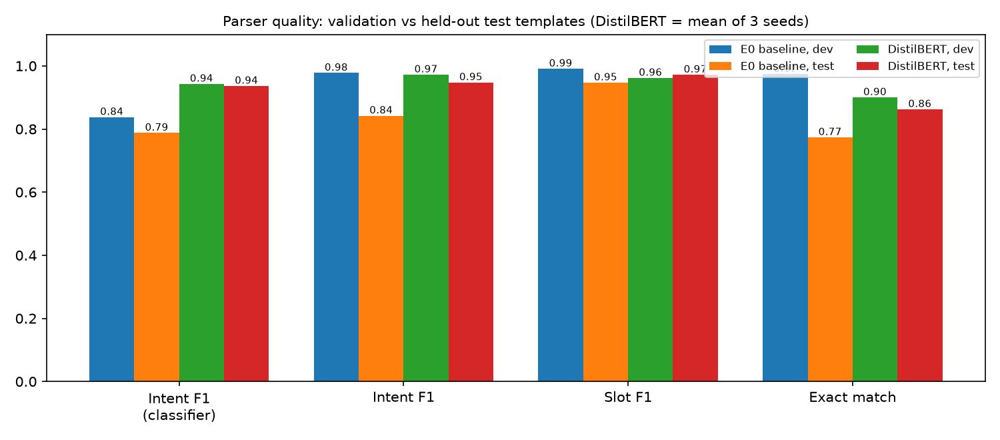
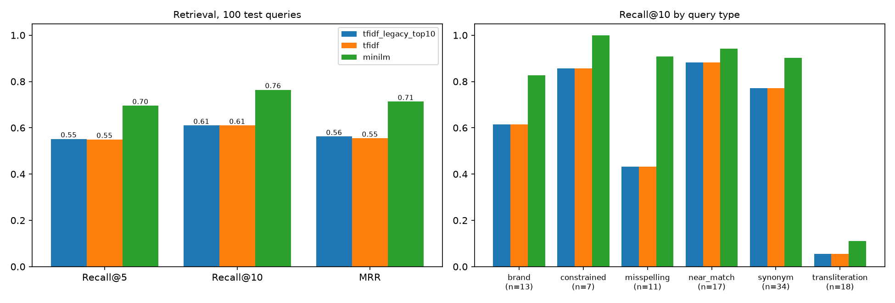
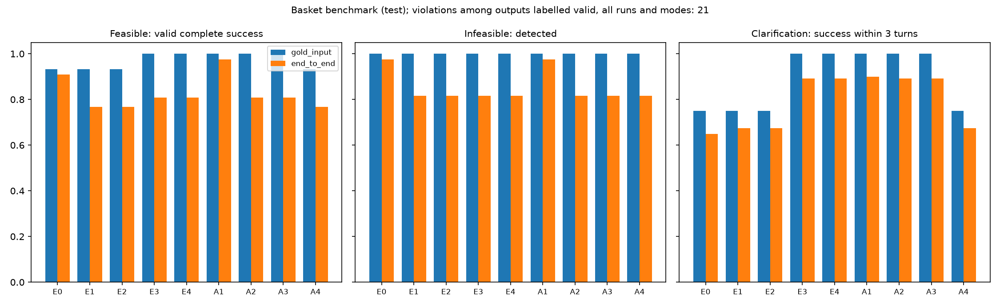
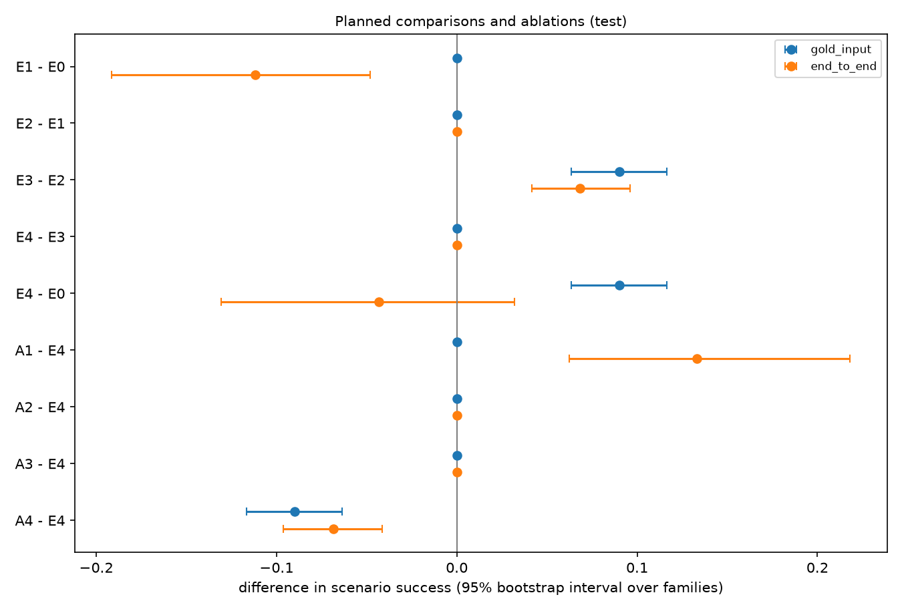
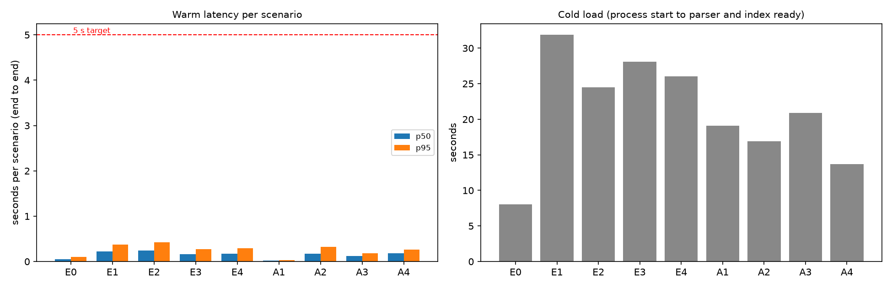

> Every number in this report comes from a file in the repository produced by committed
> code; the source of each table is named under it. **All prices are simulated.**

# Abstract

SmartCart turns a free-text grocery request into a complete basket of whole product packs
that covers every ingredient, subtracts the user's pantry, respects diets and exclusions
and stays within budget — or asks a clarification question, or proves that no such basket
exists. The pipeline combines a parser (a rule and TF-IDF/LinearSVC baseline, or
fine-tuned DistilBERT), per-ingredient retrieval (TF-IDF, or MiniLM with an exact FAISS
index), selection (independent cheapest choice with post-hoc filtering, or OR-Tools
CP-SAT with the hard rules applied first) and an independent validator. It uses 42
Food.com recipes, a 466-product catalog with **simulated** PKR prices, and a 10,000-user
Instacart sample for association rules and next-basket ranking. On a locked test set of
200 basket scenarios, evaluated once, constrained selection gives the correct outcome for
all 200 scenarios when the request is understood, against 182 for independent selection
(+0.090, 95% bootstrap interval [+0.064, +0.117]). Semantic retrieval improves free-text
product matching (Recall@10 0.764 against 0.610) but changes no basket, and association
scoring adds nothing to baskets and slightly lowers next-basket ranking. End to end, the
parser decides success: the rule-based parser with CP-SAT scores 192/200, against
164–168 with DistilBERT, whose errors on unseen phrasings cause most failures. All
requests are template-generated, so results on real user text remain untested.

# 1. Introduction

## 1.1 Scenario

A shopper describes a meal in their own words — *"vegetarian pasta dinner for four under
2,000 rupees, I already have 250 g of flour"* — and wants a basket they can actually buy:
every ingredient covered in whole packs, nothing they already have bought again, their
diet respected, and the total within budget. If the request is ambiguous, they would
rather be asked one short question than be given a wrong basket. If no basket can meet
the request, they want to be told so, with the reason, rather than be given a basket that
quietly breaks one of their rules.

SmartCart is an offline assistant for that scenario. It reads an English request, extracts
a structured request (dish or grocery list, servings, quantities, pantry items, budget,
diet, exclusions), retrieves candidate products for every ingredient, selects one product
per ingredient under the hard constraints, and checks the result with an independent
validator before showing it with short explanations.

## 1.2 Research questions

The project compares methods on complete, constrained baskets rather than on isolated
ranking scores:

- **RQ1.** Does semantic retrieval (MiniLM sentence embeddings with an exact FAISS index)
  improve product matching over a lexical baseline (TF-IDF) on grocery paraphrases and
  ingredient synonyms?
- **RQ2.** Does explicit constrained selection (OR-Tools CP-SAT) improve the rate of
  valid complete baskets over independent ranking with post-hoc filtering?
- **RQ3.** Once the same hard constraints are enforced, does association-aware scoring
  (rules mined from Instacart orders) add basket relevance or personalised ranking value?

RQ3 was expected to show a small or negative gain, and the plan committed to reporting it
as measured.

## 1.3 Scope

| In scope | Out of scope |
| --- | --- |
| English text requests | Voice and image input |
| One offline catalog in one currency (PKR) | Live inventory, real prices, multiple stores |
| 42 curated recipes and explicit grocery lists | Arbitrary dishes; checkout and payment |
| Optional purchase history (Instacart sample) | Mixing products to cover one ingredient |
| A local Streamlit demonstration | A deployed service, paid LLM calls |

**All product prices and pack attributes are simulated** (PKR-labelled, flagged per
attribute in the catalog and shown on every interface screen). The results support an
offline comparison of methods, not claims about real prices or savings.

## 1.4 Contribution

This is a course-project contribution, not a new algorithm and not a claim of a first
system of its kind. It consists of:

1. a **controlled comparison** of parsing, retrieval, selection and association scoring on
   complete, quantity-aware, budget-constrained baskets, with every component swapped one
   at a time (runs E0–E4 and ablations A1–A4), each measured both with the gold request
   and end to end;
2. **benchmarks with exact labels**: 900 annotated requests, 200 test and 50 development
   basket scenarios whose feasible / infeasible / clarification labels come from an exact
   minimum-cost checker, and 150 retrieval queries, with the test files locked by hash
   before any model was evaluated on them;
3. a **constrained selector that proves infeasibility** (over the whole catalog, with the
   minimum budget that would work) and never reports a timeout as infeasible, behind an
   independent validator;
4. a reproducible package: one command per result, each with a `--check` mode, and a run
   manifest.

## 1.5 Definition of success

The primary outcome is **valid complete success**, judged against the *annotated* (gold)
request, including any constraint the parser missed:

- a feasible scenario succeeds only if the basket covers every required ingredient and
  quantity, meets every hard rule (diet, exclusions, availability), uses only catalog
  products and stays within budget;
- an infeasible scenario succeeds only if the system detects that no valid basket exists;
- a clarification scenario succeeds only if the system asks the right kind of question and
  then, after the simulated user's answer, produces the correct outcome within three
  turns.

Feasible, infeasible and clarification scenarios are scored separately. Refusing a
feasible request is a failure (a *false rejection*), a solver timeout never counts as
detecting infeasibility, and failed outputs stay in every denominator.

# 2. Literature review

The review covers 15 peer-reviewed papers from 2019–2025, selected from the team's
literature matrix; the full comparison table (task, constraints, method, data,
evaluation, relation to SmartCart) is in `docs/literature/review.md`. Sentence-BERT
(2019) is kept as the foundational reference for the retrieval component. The methods
and results of the closest work — constrained food QA [S7], the next-basket reality check
[S8], TIFU-KNN [S9], Sentence-BERT [S10], ChatCRS [S11] and ReCANet [S12] — were read in
full. References [S7]–[S12] and [L7]–[L15] follow the rows of that table. Numbers from
different papers come from different tasks and are not comparable.

## 2.1 Food and grocery recommendation under constraints

The closest work is pFoodReQ [S7], which treats personalised food recommendation as
constrained question answering over a food knowledge graph of about one million recipes.
A question is expanded with the user's ingredient likes, allergies and nutrient
guidelines, numeric ranges are checked symbolically in the graph, and negations are
marked with constraint tags; the model returns every recipe that satisfies the
constraints. Its benchmark is template-generated (56 templates, 8,430 questions, with an
out-of-domain test subset), and its ablations show that making the constraints explicit
matters most: without query expansion, F1 falls from 63.7 to 4.2. Recipe recommenders
such as RecipeRec [L11] learn user–recipe–ingredient relations with graph models. Neither
line of work turns a dish into a purchasable set of whole product packs, subtracts what
the user already has, enforces a total budget, or states when no valid basket exists.

## 2.2 Next-basket recommendation and repeat purchases

Grocery purchase histories are dominated by repeat purchases. ReCANet [S12] reports that,
averaged over six datasets, more than half of next-basket recall comes from items the user
has bought before, and models each previously bought item's purchase gaps with LSTMs; it
improves on TIFU-KNN by a few per cent (Instacart Recall@10 0.359 against 0.343) but by
design recommends only previously bought items. The reality check [S8] separates repeat
from explore performance and finds that repeat items account for over 97% of the
performance of repeat-biased methods on Instacart and Dunnhumby, and that a personal
top-frequency baseline beats several deep models. TIFU-KNN [S9] builds directly on
personal item frequency, and time-aware weighting [L8] adds purchase timing. SmartCart's
Track B follows this practice: personal frequency is the baseline to beat, and repeat and
new items are reported separately.

## 2.3 Semantic retrieval

Sentence-BERT [S10] fine-tunes BERT in a siamese structure so that sentences can be
compared by the cosine of independent embeddings, reducing the search for the most
similar pair among 10,000 sentences from about 65 hours to about 5 seconds. Dense
retrievers such as DPR [L15] outperform BM25 on open-domain question answering, and
M3-Embedding [L7] extends dense retrieval to more than 100 languages. These results come
from general text; whether they hold for short grocery queries with brands, misspellings
and transliterated ingredient names is what RQ1 measures.

## 2.4 Conversational recommendation and clarification

Conversational recommenders elicit preferences through questions and feedback rather than
a single ranked list [L12]. ChatCRS [S11] grounds an LLM in knowledge retrieved from a
graph and in planned dialogue goals, improving recommendation accuracy and the
informativeness of responses over LLM baselines; UniCRS [L10] unifies recommendation and
response generation with knowledge-enhanced prompts, and CRSLab [L13] provides modular,
reproducible comparisons. iEvaLM [L9] evaluates conversational recommenders
interactively with simulated users. Joint intent and slot models [L14] extract structure
from requests. SmartCart borrows the typed clarification question, the simulated user and
the modular comparison, but scores every final output with a deterministic validator, so
fluent conversation is never counted as success on its own.

## 2.5 Gap

Among the 15 reviewed papers, none evaluates complete, quantity-aware, budget-constrained
baskets built from free-text requests, scored against the user's annotated constraints and
compared with independent item ranking plus post-hoc filtering. The food-constraint work
stops at recipes, next-basket work predicts purchases without a stated goal or hard
constraints, and retrieval and conversational work measure matching or dialogue quality.
This is a gap in the reviewed literature only; no exhaustive novelty search was done, and
SmartCart is not presented as the first system of its kind.

# 3. Methodology

## 3.1 Data flow

```
request text
  → parser → StructuredRequest
  → requirements: recipe × servings, + items, − pantry, − exclusions
  → retrieval per ingredient (top-k candidates)
  → selection: independent cheapest + post-hoc filter, or CP-SAT
  → independent validator → basket, status, explanations
```

A request may also carry an Instacart user ID; the association module then supplies
history and pair scores to the selector, and is evaluated on its own on next-basket
ranking (Track B).

## 3.2 Data

**Recipes.** 42 recipes from the Food.com Recipes and Reviews dataset (Kaggle, irkaal)
across 27 meal families. The dataset gives servings but no units, and its quantity lists
are misaligned for "X or Y" lines, so amounts and units were taken from each recipe's
food.com page: 51 pages were checked, 39 accepted and 12 rejected because a line could
not be converted without inventing an amount (the remaining 3 recipes come from the
earlier pilot). Pork and alcohol recipes were excluded for the PKR context.

**Ingredients and catalog.** 118 canonical ingredients (98 used in recipes, 20
distractors for misleading near-matches) with 167 reviewed aliases, including British
names and Urdu transliterations (dahi, aloo, pyaz, atta). The catalog has **466 simulated
products** under fictional house brands, with several pack sizes per ingredient, prices
in integer paisa, availability (4 products unavailable) and dietary values for five
diets. Each dietary value is `allowed`, `disallowed` or `unknown`, and **`unknown` never
satisfies a diet**. Unit conversions use NIST SP 811 factors and, for cup-to-gram
conversions, the King Arthur Baking weight chart.

**Transactions.** A deterministic sample of 10,000 Instacart users (Instacart Market
Basket Analysis, Kaggle), drawn in ascending `sha256(seed:user_id)` order among users with
at least five usable orders. For each user the last order is test, the second-to-last is
validation and the rest are training (163,626 / 10,000 / 10,000 orders). Instacart
products are mapped to catalog ingredients by 119 ordered rules (aisle sets with include
and exclude patterns), mapping 3,288 products to all 118 ingredients; a held-out review
of 150 mapped products found a precision of 134/150 = 89.3% (95% Wilson interval
83.4–93.3%). No catalog product has an Instacart ID, because the catalog is simulated, so
all associations are at ingredient level.

## 3.3 Benchmarks and splits

**NLU annotations.** 900 requests: 300 seeds × 3 paraphrases, split 600 / 150 / 150
(train / validation / test) by seed. Each example has tokens, BIO tags over 10 slot types,
character spans with normalised values, quantity-to-item attachment, the session for
revisions and the gold StructuredRequest. Intents per split: 240/60/60 `plan_meal`,
150/36/36 grocery lists, 120/30/30 revisions, 90/24/24 unsupported.

**Basket scenarios.** 200 test scenarios — 120 feasible, 40 infeasible (25 budgets below
the minimum cost, 15 diet conflicts) and 40 clarification — and 50 development scenarios
(30 / 10 / 10). Each label is produced by the **gold feasibility checker**, which resolves
the requirements, builds the eligible options per line and finds the exact minimum-cost
basket by depth-first enumeration. Clarification scenarios carry the user's answer and a
resolved request with its own label. 40 test scenarios include an Instacart user whose
training history shares at least two required ingredients.

**Retrieval queries.** 150 hand-written queries (50 development / 100 test) over
ingredient groups that never overlap between splits: synonyms, real brand names,
misspellings, Urdu transliterations, misleading near-matches and diet-constrained
queries. The relevant set is every available product of the target ingredient that is
`allowed` for the query's diet.

**Grouping.** Whole meal families go to one split (16 / 8 / 18 recipes), and phrasing
templates are partitioned by split, so validation and test text uses templates never seen
in training. After a two-round review, the five test files were **locked by SHA-256**
(`docs/benchmark_lock.md`) before any model was evaluated on them.

**Basket semantics** (`docs/benchmark_policy.md`): a missing servings count means the
recipe's base servings; budgets are inclusive caps; a request with no budget has no cost
limit; an exclusion drops the ingredient from the requirements and bans its products;
each line takes one product type in whole packs.

## 3.4 Models

**Baseline parser (E0).** Intent: a TF-IDF (character 2–4-grams) + LinearSVC classifier
(C = 0.1), chosen on validation from a 15-entry grid and trained on the 600 training
examples. Slots: longest-match gazetteers over catalog ingredient names, aliases, recipe
aliases and diet words; number, unit and currency rules; role rules (a number before a
unit or ingredient is a quantity; next to a currency word, with a `k` or `/-` suffix, or
≥ 100 it is a budget; any other integer up to 30 is servings); negation and pantry cue
words. Two dialogue-state rules sit on top of the classifier: `revise_basket` needs a
session, and with a session a request that names no meal is a revision.

**Transformer parser.** DistilBERT (`distilbert-base-uncased`, pinned revision), fine-tuned
as two models per seed — sequence classification for intent and token classification over
21 BIO tags for slots — with seeds 13, 42 and 7 (AdamW, learning rate 5e-5, batch 16,
weight decay 0.01, 10% warm-up, 6 epochs for intent and 8 for slots, best validation
epoch kept). It shares the baseline's normalisation, clarification and dialogue rules,
so the comparison isolates the models. Intent confidence is temperature-scaled per seed
on validation data, and a low-confidence threshold (also chosen on validation) triggers a
runtime question.

**Retrieval.** For each required ingredient the query is its canonical name.
TF-IDF (word 1–2-grams) and MiniLM (`all-MiniLM-L6-v2`, pinned revision, L2-normalised
embeddings in an exact `IndexFlatIP`) rank the whole catalog. Scores are mapped to [0, 1],
rounded to 6 decimals and ties are broken by product ID. The product text
(`display_name_ingredient`) and the candidate count (k = 40) were chosen on development
queries by rules written before the results were computed. Retrieval never applies hard
rules.

**Associations.** FP-Growth (mlxtend) on the ingredient sets of the training orders;
thresholds (count ≥ 200, confidence ≥ 0.2) and weight (0.1) were chosen on one half of
the validation users and reported on the other half. The pair score is `1 − 1/lift`
(bounded in [0, 1], symmetric); the history score is the share of a user's training orders
that contain the ingredient.

**Selection.**

- *Independent (E0):* for each line, the cheapest available candidate with the right
  ingredient and unit among the top 10 (or 40), chosen independently; then a **post-hoc
  diet filter** drops products that are not `allowed`, leaving the line uncovered, and the
  total is compared with the budget.
- *Constrained (CP-SAT):* the hard rules (ingredient and unit, availability, every diet
  `allowed`, exclusions) decide which candidates are options before any optimisation. The
  model has one Boolean per option, exactly one option per line, and `Σ cost ≤ budget`.
  The objective adds relevance, history and pair bonuses (pairs through AND-linked
  Booleans) and subtracts cost and surplus penalties, each normalised to [0, 1], scaled to
  integers, with a deterministic tie-break (cheaper option, then product ID). If the
  candidate pool has no feasible basket, the model is rebuilt over every eligible catalog
  product; if that is infeasible too, the request is **proven infeasible in scope**, and
  for a budget conflict the minimum-cost basket is solved and reported as the suggested
  budget. CP-SAT runs single-threaded, seed 0, with a 10-second limit; a timeout is its own
  status.
- *Validator:* every basket labelled valid has passed an independent check that recomputes
  needs, units, availability, diets, exclusions, packs, line costs, duplicates, missing
  lines and the budget from product IDs and pack counts.

## 3.5 Runs and modes

| Run | Parser | Retrieval | Selection |
| --- | --- | --- | --- |
| E0 | baseline | TF-IDF, top 10 | independent + post-hoc filter |
| E1 | DistilBERT | as E0 | as E0 |
| E2 | DistilBERT | MiniLM, top 40 | as E0 |
| E3 | DistilBERT | MiniLM, top 40 | CP-SAT, history and pair weights 0 |
| E4 | DistilBERT | MiniLM, top 40 | CP-SAT, history 0.1, pair 0.1 |
| A1 | baseline | as E4 | as E4 |
| A2 | DistilBERT | TF-IDF, top 40 | as E4 |
| A3 | DistilBERT | as E4 | CP-SAT, pair weight 0 |
| A4 | DistilBERT | as E4 | independent + post-hoc filter |

*Source: `configs/experiments/*.json`.* A4 coincides with E2 by construction (the
independent selector ignores the association terms) and was run separately as a check.

Every run is evaluated in two modes on the same 200 scenarios:

- **gold input** (component-isolated): the gold StructuredRequest is given to the
  selector, so the parser is not used;
- **end to end**: the run's parser reads the scenario text; a simulated user answers one
  question, and at most three questions are allowed. DistilBERT runs are repeated for
  each of the three seeds.

## 3.6 Metrics and statistics

- **NLU:** intent macro-F1 (with and without the dialogue rules), entity-level slot
  micro-F1, quantity attachment, exact budget and servings, clarification precision,
  recall and type accuracy, unnecessary clarifications, and whole-request exact match.
- **Retrieval:** Recall@5, Recall@10 and MRR over the whole catalog.
- **Baskets:** valid complete success on the 120 feasible scenarios, mean coverage,
  violations among outputs labelled valid, infeasibility detection on the 40 (plus false
  rejections), clarification success within three turns on the 40 (plus unnecessary
  questions), solver timeouts, and warm p50/p95 latency and cold load time.
- **Track B:** Recall@10 and NDCG@10 of each user's final (test) order over the 118
  ingredients, for all, repeat and new items, comparing popularity, personal frequency
  [S9] and frequency + association.
- **Uncertainty:** differences in scenario success between runs use a **paired bootstrap
  over the 24 test scenario families** (2,000 resamples, seed 20261128, 95% percentile
  intervals); multi-seed runs use each scenario's mean success over seeds. Track B
  differences use a paired bootstrap over users.

## 3.7 Experimental protocol

All tuning used training and validation data only. Every configuration was frozen in
`configs/` before the test files were read, and the test files were evaluated **once**, in
a single run of `scripts/evaluate_all.py` on 2026-11-28, after a hash check of the locked
files. No configuration, code or threshold was changed afterwards.

# 4. Implementation

## 4.1 Modules

| Package (`src/smartcart/`) | Role |
| --- | --- |
| `data` | Catalog contract and build, Instacart sampling, split and mapping |
| `benchmarks` | Grouped splits, request rendering, gold requests, scenario designs |
| `validation` | Gold feasibility checker (exact enumeration) and the basket validator |
| `nlu` | Baseline and DistilBERT parsers, span normalisation, clarification, metrics |
| `retrieval` | Product text, TF-IDF and MiniLM + FAISS retrieval, index cache, evaluation |
| `associations` | Ingredient-level transactions, FP-Growth rules, pair and history scores, Track B |
| `optimization` | Pack arithmetic and the CP-SAT selector |
| `explanations` | Sentences built only from verified basket records |
| `pipeline` | E0, the constrained pipeline and the Phase 11 experiment harness |
| `app` | Interface logic (`session.py`); `app.py` only draws Streamlit widgets |

Each pipeline step is a script with a frozen configuration and a `--check` flag that
rebuilds its outputs in memory and compares them with the committed files. The test suite
has 259 tests.

## 4.2 Environment

Python 3.11.9 on a Windows 10 laptop with 4 CPU cores; everything runs on the CPU. Every
package version is pinned in `requirements-lock.txt` (key versions: torch 2.15.0+cpu,
transformers 5.24.1, sentence-transformers 6.3.0, faiss-cpu 1.16.0, scikit-learn 1.9.1,
ortools 9.15.6755, mlxtend 0.25.0, streamlit 1.67.0). Both Hugging Face models are pinned
to revisions and loaded offline. `results/run_manifest.json` records the seeds, the
versions, the model revisions, the SHA-256 of the fine-tuned checkpoints and the source
archives, and the hash of every committed input and result.

## 4.3 Training setup

DistilBERT training took about 75 minutes on the CPU (4 threads) for the three seeds.
Only the 600 training examples update the weights; the validation set selects the epoch,
fits the temperature and sets the confidence threshold. Kept epochs were 5 / 2 / 3 for
intent and 4 / 5 / 5 for slots (seeds 13 / 42 / 7). The baseline's intent grid and its
dialogue rules were also chosen on validation data.

## 4.4 Catalog assumptions

Products, pack sizes, prices and availability are simulated, and each simulated attribute
is listed in the product's `simulated_fields`. Spices, condiments and purées are stocked by
volume. Dietary labels were assigned per product, with 12 dietary variants (for example
vegetarian cheddar, gluten-free tamari) and `unknown` wherever the label could not be
justified; the 20 pilot products keep all-`unknown` labels.

## 4.5 Solver handling

- One product type per line, bought in whole packs; the number of packs is the minimum
  that covers the need.
- The candidate pool is the top 40 per ingredient; it is expanded to the whole eligible
  catalog only to prove infeasibility or when the pool has no feasible basket.
- Statuses: `valid`, `needs_clarification`, `no_basket_in_candidate_pool`,
  `infeasible_in_scope` (with a suggested budget for budget conflicts), `solver_timeout`,
  `unsupported`, `invalid_request`. A basket is labelled `valid` only after the validator
  passes.
- On validation data, all 20 cost × surplus weight settings tied (50/50 scenarios, cost
  ratio 1.000 to the checker's minimum), so the first setting was kept by a rule fixed in
  advance. **The weights are untuned in any meaningful sense**: products of one ingredient
  share the same text and the same association scores, so the objective reduces to the
  cheapest eligible option per line on this benchmark.

## 4.6 Interface

A Streamlit app shows a simulated-price banner, "What I understood" (every extracted
field), clarification questions with an answer box and dish suggestions for broad goals,
the status (valid, needs clarification, no solution found, proven infeasible with a
"use the suggested budget" button), the basket table with packs, need, bought, leftover
and line cost, explanations, edits (budget, exclusions, diet, or a revision in words)
followed by "What changed", and CSV/JSON export. Six demonstration conversations are
scripted in `configs/app.json` and all six work. On the test laptop the cold load is
27.4 s and a warm request takes 0.19 s (p50) and 0.59 s (p95).

# 5. Results and discussion

All results in this section are on the locked test split, evaluated once.

## 5.1 Parsing

| Parser | Intent macro-F1 (classifier only) | Intent macro-F1 | Slot micro-F1 | Request exact match |
| --- | --- | --- | --- | --- |
| E0 baseline | 0.788 | 0.842 | 0.947 | 0.773 |
| DistilBERT (mean ± std, 3 seeds) | 0.936 ± 0.034 | 0.947 ± 0.028 | 0.972 ± 0.003 | 0.862 ± 0.006 |

*Table 1. NLU test split, 150 examples. Source: `results/tables/nlu.md`
(`results/metrics/test_components.json`).*



DistilBERT leads on every headline metric. The lead comes from intent classification —
especially `unsupported` requests (F1 0.75–0.96 across seeds against 0.68) and grocery
lists (1.00 against 0.86) — and from quantity attachment (0.992–0.996 against 0.875).
Exact budgets (0.971–0.981 against 0.990) and servings (0.974–0.987 against 1.000) are
slightly worse than the baseline's rules. Both parsers ask a similar number of
unnecessary questions (14–16 and 14). On validation the baseline had led on slots and
exact match (0.991 and 0.973); on test its dictionaries and rules lose more on the
held-out templates than DistilBERT does.

## 5.2 Retrieval (RQ1)

| Setting | Recall@5 | Recall@10 | MRR | R@10 misspelling | R@10 transliteration |
| --- | --- | --- | --- | --- | --- |
| TF-IDF, legacy text, top 10 (E0) | 0.552 | 0.610 | 0.562 | 0.432 | 0.056 |
| TF-IDF, frozen text | 0.549 | 0.610 | 0.555 | 0.432 | 0.056 |
| MiniLM, frozen text | 0.696 | 0.764 | 0.713 | 0.909 | 0.111 |

*Table 2. 100 test queries. Source: `results/tables/retrieval.md`; figure
`results/figures/15_retrieval_test.png`.*



MiniLM improves Recall@10 by 0.154 and MRR by 0.158 over TF-IDF, with the largest gains on
misspellings (0.909 against 0.432), brand names (0.827 against 0.615) and synonyms (0.902
against 0.772). Neither method handles Urdu transliterations (0.111 and 0.056): MiniLM
ranks paprika, potato, peanut butter and a lamb chop first for *kheera*, *kali mirch*,
*makhan* and *gobhi*. The 0.90 Recall@10 target is missed.

**Answer to RQ1:** yes for free-text product matching. In the basket pipeline, however,
retrieval changes nothing (E2 − E1 = 0 and A2 − E4 = 0 in Table 5): the pipeline queries
canonical ingredient names, for which both methods' pools already contain the right
products, and the parser maps aliases (including transliterations) to ingredient IDs
before retrieval.

## 5.3 Baskets

| Run | Mode | Feasible success (/120) | Coverage | Violations among valid | Infeasible detected (/40) | False rejections | Clarification success (/40) | Unnecessary questions |
| --- | --- | --- | --- | --- | --- | --- | --- | --- |
| E0 | gold input | 112 | 0.976 | 0 | 40 | 18 | 30 | 0 |
| E0 | end to end | 109 | 0.959 | 0 | 39 | 19 | 26 | 2 |
| E1 = E2 = A4 | end to end | 92.0 (91–93) | 0.851 | 3.0 (2–4) | 32.7 | 19.0 | 27.0 | 23.0 |
| E3 = E4 = A2 = A3 | gold input | 120 | 1.000 | 0 | 40 | 0 | 40 | 0 |
| E3 = E4 = A2 = A3 | end to end | 97.0 (96–98) | 0.822 | 3.0 (2–4) | 32.7 | 5.3 | 35.7 | 23.0 |
| A1 | end to end | 117 | 0.975 | 0 | 39 | 1 | 36 | 2 |

*Table 3. 200 test scenarios. DistilBERT end-to-end runs show the mean over 3 seeds
(min–max). E1, E2 and A4 with gold input equal E0; A1 with gold input equals E4. There
were 0 solver timeouts in every run. Source: `results/tables/baskets.md`; figure
`results/figures/16_basket_success_validity_test.png`.*



## 5.4 Constrained selection (RQ2)

With the gold request, the constrained selector produces the correct outcome on all 200
scenarios: 120/120 valid complete baskets, all 40 infeasible scenarios proven (with the
minimum budget reported for every budget conflict), 40/40 clarification scenarios, no
violations and no timeouts. The independent selector fails 18 scenarios, all of them
involving a diet: 8 feasible diet scenarios and 10 clarification scenarios whose answer
adds a diet. In each, the cheapest product on some line is `unknown` for the diet, the
post-hoc filter drops it, and the line is left uncovered — a false rejection. The
constrained selector applies the diet first and buys the cheapest product that is
`allowed`.

The gain is +0.090 [+0.064, +0.117] with gold input and +0.068 [+0.041, +0.096] end to
end (E3 − E2 in Table 5). It is concentrated in diet scenarios, as predicted on
validation: without a diet, line costs simply add up and each line takes one product, so
the per-line cheapest choice already is the minimum-cost basket. A larger gap would need
interacting constraints (shared packs, substitutions, multi-product lines) that this
benchmark does not contain.

The constrained selector's infeasibility detection is a proof rather than a guess. The
independent selector also detects all 40 infeasible scenarios with gold input, but only
because its pool happened to contain the cheapest compatible product for every line; it
cannot distinguish "no basket exists" from "my heuristic failed".

**Answer to RQ2:** yes. Constrained selection removes every selection failure on this
benchmark and turns "over budget" into a proven statement with the budget that would
work.

## 5.5 Association-aware scoring (RQ3)

On baskets, E4 = E3 and A3 = E4 on every scenario in both modes (Table 5). This was
established before the test run: with ingredient-level rules, every product of an
ingredient receives the same history and pair score, so the terms cannot change which
product is chosen.

| Ranker | Recall@10 | NDCG@10 | New-item Recall@10 |
| --- | --- | --- | --- |
| Popularity | 0.502 | 0.361 | 0.261 |
| Personal frequency | 0.703 | 0.582 | 0.104 |
| Frequency + association | 0.686 | 0.572 | 0.073 |

*Table 4. Track B: each user's final order, 7,413 users (2,587 excluded because their
final order contains no mapped ingredient). Source: `results/tables/track_b.md`.*

Personal frequency is a strong baseline, as reported in [S9]: it beats popularity by
+0.221 NDCG@10 [+0.215, +0.229]. Adding the association term lowers NDCG@10 by 0.0105
[−0.0122, −0.0089] and Recall@10 by 0.0170 [−0.0204, −0.0135]; new-item recall falls
from 0.104 to 0.073. The strongest rules mix complements with substitutes (for example
two kinds of broth bought together), and a "goes well with" bonus is wrong for
substitutes (`docs/association_analysis.md`).

**Answer to RQ3:** no. Association scoring adds nothing to basket selection here, and it
slightly lowers next-basket ranking quality. This null result matches the validation
result of Phase 8.

## 5.6 Uncertainty and ablations

| Comparison | Gold input | End to end |
| --- | --- | --- |
| E1 − E0 (parser) | 0 | −0.112 [−0.191, −0.048] |
| E2 − E1 (retrieval) | 0 | 0 |
| E3 − E2 (constrained selection) | +0.090 [+0.064, +0.117] | +0.068 [+0.041, +0.096] |
| E4 − E3 (association terms) | 0 | 0 |
| E4 − E0 (full system vs baseline) | +0.090 [+0.064, +0.117] | −0.043 [−0.131, +0.032] |
| A1 − E4 (baseline parser) | 0 | +0.133 [+0.062, +0.218] |
| A2 − E4 (TF-IDF retrieval) | 0 | 0 |
| A3 − E4 (pair weight 0) | 0 | 0 |
| A4 − E4 (independent selection) | −0.090 [−0.117, −0.064] | −0.068 [−0.096, −0.041] |

*Table 5. Difference in scenario success (share of 200), 95% paired bootstrap interval
over the 24 test families. Source: `results/tables/comparisons.md`; figure
`results/figures/17_ablations_test.png`.*



The ablations isolate each component. Swapping the selector (A4) is the only change that
matters with gold input. End to end, the **parser** dominates: the full system with
DistilBERT is not distinguishable from the baseline (E4 − E0 = −0.043, interval includes
0), and replacing DistilBERT with the baseline parser in the full system (A1) adds
+0.133. A1 — rule-based parser, MiniLM retrieval, CP-SAT — is the best end-to-end system
measured: 192/200, with 0 violations, 39/40 infeasible scenarios detected and 1 false
rejection.

## 5.7 Why the better NLU parser loses end to end

Table 1 and Table 3 point in opposite directions. Three facts explain it:

1. **Different request mix.** DistilBERT's NLU-test lead is on revisions, unsupported
   requests and grocery lists. On `plan_meal`, which is 180 of the 200 basket scenarios,
   the baseline is level with or ahead of DistilBERT on the NLU test (whole-request exact
   match 50/60 against 45–50/60 across the three seeds).
2. **Held-out phrasings.** The basket test uses phrasings that never occur in the 600
   training texts: "We're having …" opens 43 of the 200 requests, "is my limit" appears
   in 55, "for a family of" in 56, "I'm avoiding" in 13 and "I don't want any" in 7.
   DistilBERT misses the dish in 24% of "We're having" requests (29 of 123 over the three
   seeds) against at most 6% for the other templates; it attaches a number to the wrong
   slot across a comma ("for a family of 4, 743 is my limit" becomes a PKR 4 budget, and
   the request is falsely proven infeasible); and it reads exclusions as pantry items.
   The baseline's dictionaries and cue words handle most of these.
3. **Errors that look valid.** A missed constraint is invisible to the validator, which
   checks the request it is given. DistilBERT produced 2–4 baskets per seed that were
   valid for the parsed request but violated the user's real one (a missed "no meat", a
   missed serving count). The baseline parser produced none.

An important caveat applies to the baseline's win (Section 5.10): its cue-word lists were
written by the same agent that wrote the benchmark generator, which contains the test
templates.

## 5.8 Failure analysis

`docs/failure_analysis.md` analyses 16 representative cases from the test rows. In
summary, for E4 end to end (seed 42, 36 failures): 22 unnecessary questions (17 asking
for a dish that was named, 3 asking for a pantry quantity of an excluded item, 2 about a
diet), 5 false rejections from a misread budget or serving count, 4 baskets labelled valid
that violate the gold request, 2 dish questions that were never resolved and 3 scenarios
that needed a question but received a basket. 22 scenarios fail for all three seeds and
30 for one or two, so the seed matters for about a quarter of the failures. **With the
gold request no run fails because of selection**; every end-to-end failure starts in the
parser.

## 5.9 Runtime

| Run | Cold load (s) | Warm end-to-end p50 / p95 (s) |
| --- | --- | --- |
| E0 | 8.0 | 0.052 / 0.105 |
| E4 | 26.1 | 0.169 / 0.295 |
| A1 | 19.1 | 0.016 / 0.035 |
| Slowest warm (E2) | 24.5 | 0.243 / 0.424 |

*Table 6. Per scenario, test split, Windows 10 laptop with 4 CPUs. Source:
`results/tables/latency.md` (machine-dependent, not part of `--check`); figure
`results/figures/18_latency_test.png`.*



Every configuration is far below the 5 s target once warm. The cold load is dominated by
loading PyTorch, DistilBERT and MiniLM once. CP-SAT itself takes 1–2 ms per request.

## 5.10 Targets

| Target | Actual | Outcome |
| --- | --- | --- |
| Intent macro-F1 ≥ 0.85 | DistilBERT 0.947; baseline 0.842 | met by DistilBERT; missed by the baseline |
| Slot F1 ≥ 0.85 | 0.972 and 0.947 | met |
| Exact numeric fields ≥ 95% | budget 0.971–0.990, servings 0.974–1.000 | met |
| Retrieval Recall@10 ≥ 0.90 | MiniLM 0.764; TF-IDF 0.610 | missed |
| Mean coverage ≥ 95% | gold input 1.000; E4 end to end 0.822; A1 0.975 | met except E4 end to end |
| Valid complete success ≥ 90% | E4 gold 100%; E4 end to end 80.8%; A1 97.5%; E0 end to end 90.8% | met except E4 end to end |
| 0 violations among valid | 0 with gold input and with the baseline parser; 2–4 per DistilBERT seed | missed end to end with DistilBERT |
| Infeasible detection ≥ 90% | gold 100%; E4 end to end 81.7%; A1 97.5% | met except E4 end to end |
| Clarification within 3 turns ≥ 85% | E4 end to end 89%; A1 90%; E0 end to end 65% | met by E4 and A1 |
| Warm p95 < 5 s | ≤ 0.42 s | met |
| Track B: compare with baselines | frequency > popularity; association lowers both metrics | reported |

*Table 7. Engineering targets from the build plan against measured values.*

## 5.11 Limitations and threats to validity

- **Template-generated text.** All NLU and basket requests were generated from templates
  (held out by split) rather than written by users. Absolute scores are likely optimistic,
  and the ranking of the two parsers on real user text is unknown.
- **Possible leakage into the baseline's rules.** The baseline's cue-word lists were
  written from training and validation examples, but by a build agent that had read the
  benchmark generator, which contains the test templates. No test example was parsed or
  scored before the test run, but the baseline's end-to-end win (A1) may be inflated by
  this knowledge, and should be read with that in mind.
- **Reviews were not independent.** The annotation review, the recipe review and the
  Instacart mapping review were each done by one reviewer (the build agent that also wrote
  the generator and rules). The planned second-person annotation check is outstanding.
- **Simulated catalog.** Prices, pack sizes and availability are simulated; no claim about
  real prices or savings is possible. Products of one ingredient share their display text,
  which makes per-ingredient retrieval and the selection objective simpler than in a real
  catalog.
- **Separable selection.** Without interacting constraints the per-line cheapest choice is
  optimal, which limits how much constrained selection can gain here.
- **Ingredient-level associations.** No catalog product has an Instacart ID, so
  association and history terms cannot distinguish products of one ingredient.
- **Single test run without a pre-run commit.** The Phase 11 configurations were meant to
  be committed before the test run; that commit was skipped. Their SHA-256 checksums were
  recorded before and after the run and are identical, and the files were committed
  unchanged.
- **Small test sets.** 100 retrieval queries and 24 test families give wide intervals for
  some comparisons (for example E4 − E0).
- **One machine.** Latency was measured on one laptop.

# 6. Conclusion

**RQ1 — semantic retrieval.** MiniLM matches products better than TF-IDF on free text
(Recall@10 0.764 against 0.610), especially for misspellings, brands and synonyms, but
neither handles transliterations, the 0.90 target is missed, and retrieval does not change
any basket in this pipeline, because the parser resolves requests to canonical
ingredients first.

**RQ2 — constrained selection.** Yes. Applying the hard rules before selection and solving
with CP-SAT gives 200/200 correct outcomes with the gold request, against 182/200 for
independent ranking with post-hoc filtering (+0.090 [+0.064, +0.117]); it proves every
infeasible case with the budget that would work, and the gain holds end to end (+0.068).

**RQ3 — association-aware scoring.** No. At ingredient level the terms cannot change a
basket, and on next-basket ranking they lower NDCG@10 by about 0.01 against personal
frequency, which is itself a strong baseline.

**Measured contributions.** A pipeline whose selector and validator are correct on every
benchmark scenario when the request is understood; benchmarks with exact labels and
locked test files; and a component-by-component comparison showing that, end to end, the
parser — not retrieval or association scoring — determines success. The best measured
system combines the rule-based parser with MiniLM retrieval and CP-SAT (192/200, no
violations).

**Open issues.** Parser robustness to unseen phrasings (the main cause of end-to-end
failure); confirming extracted constraints with the user before buying, since the
validator cannot catch a missed constraint; transliterated queries; an evaluation on
requests written by real users, with an independent annotation review; and a richer
catalog in which products of one ingredient differ, so that relevance and association
terms could matter.

# Contribution summary

[TEAM — fill in each member's contribution, for example: scope and literature review;
data and benchmarks; parsers; retrieval; associations; solver; interface; experiments;
report.]

# Data sources and terms

- **Instacart Market Basket Analysis** (Kaggle) [S1]. The provider permits non-commercial
  use and restricts redistribution; the pipeline commits only IDs, the ingredient mapping,
  counts and ingredient-level rules, and keeps basket rows in an ignored folder. (Two
  early exploratory files with Instacart rows remain in the repository from before the
  project plan; no reported result uses them.)
- **Food.com Recipes and Reviews** by irkaal (Kaggle; labelled CC0 on Kaggle) [S2]. Recipe
  IDs and servings come from it; amounts and units come from each recipe's food.com page.
  Recipe text belongs to its authors and is used for non-commercial coursework only.
- **Catalog:** simulated by the team; every simulated attribute is flagged.
- **Models:** `distilbert-base-uncased` and `all-MiniLM-L6-v2` (Apache 2.0), from the
  Hugging Face Hub [S4], [S5].

# Declaration of AI and tool assistance

[TEAM — confirm or edit before submitting.] This project was built with the help of an AI
coding agent (Claude, by Anthropic, used through Claude Code). Following the team's build
plan, the agent wrote most of the code, the benchmark generator and the annotation and
mapping reviews, ran the development experiments, drafted the documentation and drafted
this report. The team defined the scope and research questions, made the design
decisions recorded in `docs/progress.md`, ran every official check and the single test
evaluation on its own machine, and reviewed the results. Every number in this report
comes from a file produced by committed code.

# References

Implementation sources:

- [S1] Instacart. *The Instacart Online Grocery Shopping Dataset 2017*, accessed through
  Kaggle: Instacart Market Basket Analysis.
- [S2] irkaal. *Food.com Recipes and Reviews*, Kaggle dataset.
- [S3] scikit-learn developers. *Common pitfalls and recommended practices* (data
  leakage), scikit-learn documentation.
- [S4] Hugging Face. *Transformers: token classification guide*.
- [S5] Sentence Transformers. *all-MiniLM-L6-v2* model card.
- [S6] Google. *OR-Tools CP-SAT solver* documentation.

Reviewed papers (the 15 in `docs/literature/review.md`):

- [S7] Y. Chen, A. Subburathinam, C.-H. Chen, M. J. Zaki. Personalized food
  recommendation as constrained question answering over a large-scale food knowledge
  graph. *WSDM 2021*. doi:10.1145/3437963.3441816
- [S8] M. Li, S. Jullien, M. Ariannezhad, M. de Rijke. A next basket recommendation
  reality check. *ACM Transactions on Information Systems* 41(4), Article 116, 2023.
  doi:10.1145/3587153
- [S9] H. Hu, X. He, J. Gao, Z.-L. Zhang. Modeling personalized item frequency information
  for next-basket recommendation. *SIGIR 2020*. doi:10.1145/3397271.3401066
- [S10] N. Reimers, I. Gurevych. Sentence-BERT: sentence embeddings using Siamese
  BERT-networks. *EMNLP-IJCNLP 2019*. doi:10.18653/v1/D19-1410
- [S11] C. Li, Y. Deng, H. Hu, M.-Y. Kan, H. Li. ChatCRS: incorporating external knowledge
  and goal guidance for LLM-based conversational recommender systems. *Findings of NAACL
  2025*. doi:10.18653/v1/2025.findings-naacl.17
- [S12] M. Ariannezhad, S. Jullien, M. Li, M. Fang, S. Schelter, M. de Rijke. ReCANet: a
  repeat consumption-aware neural network for next basket recommendation in grocery
  shopping. *SIGIR 2022*, 1240–1250. doi:10.1145/3477495.3531708
- [L7] J. Chen, S. Xiao, P. Zhang, K. Luo, D. Lian, Z. Liu. M3-Embedding:
  multi-linguality, multi-functionality, multi-granularity text embeddings through
  self-knowledge distillation. *Findings of ACL 2024*. doi:10.18653/v1/2024.findings-acl.137
- [L8] A. Romanov, O. Lashinin, M. Ananyeva, S. Kolesnikov. Time-aware item weighting for
  the next basket recommendations. *RecSys 2023*. doi:10.1145/3604915.3608859
- [L9] X. Wang, X. Tang, X. Zhao, J. Wang, J.-R. Wen. Rethinking the evaluation for
  conversational recommendation in the era of large language models. *EMNLP 2023*.
  doi:10.18653/v1/2023.emnlp-main.621
- [L10] X. Wang, K. Zhou, J.-R. Wen, W. X. Zhao. Towards unified conversational
  recommender systems via knowledge-enhanced prompt learning. *KDD 2022*.
  doi:10.1145/3534678.3539382
- [L11] Y. Tian, C. Zhang, Z. Guo, C. Huang, R. Metoyer, N. V. Chawla. RecipeRec: a
  heterogeneous graph learning model for recipe recommendation. *IJCAI 2022*.
  doi:10.24963/ijcai.2022/481
- [L12] D. Jannach, A. Manzoor, W. Cai, L. Chen. A survey on conversational recommender
  systems. *ACM Computing Surveys* 54(5), Article 105, 2021. doi:10.1145/3453154
- [L13] K. Zhou, X. Wang, Y. Zhou, C. Shang, Y. Cheng, W. X. Zhao, Y. Li, J.-R. Wen.
  CRSLab: an open-source toolkit for building conversational recommender system.
  *ACL-IJCNLP 2021: System Demonstrations*. doi:10.18653/v1/2021.acl-demo.22
- [L14] L. Qin, T. Liu, W. Che, B. Kang, S. Zhao, T. Liu. A co-interactive transformer for
  joint slot filling and intent detection. *ICASSP 2021*.
  doi:10.1109/ICASSP39728.2021.9414110
- [L15] V. Karpukhin, B. Oğuz, S. Min, P. Lewis, L. Wu, S. Edunov, D. Chen, W.-t. Yih.
  Dense passage retrieval for open-domain question answering. *EMNLP 2020*.
  doi:10.18653/v1/2020.emnlp-main.550

Methods and tools:

- V. Sanh, L. Debut, J. Chaumond, T. Wolf. DistilBERT, a distilled version of BERT:
  smaller, faster, cheaper and lighter. arXiv:1910.01108, 2019.
- J. Johnson, M. Douze, H. Jégou. Billion-scale similarity search with GPUs. *IEEE
  Transactions on Big Data*, 2019 (FAISS).
- J. Han, J. Pei, Y. Yin. Mining frequent patterns without candidate generation. *SIGMOD
  2000* (FP-Growth).
- B. Efron, R. J. Tibshirani. *An Introduction to the Bootstrap*. Chapman & Hall, 1993.
